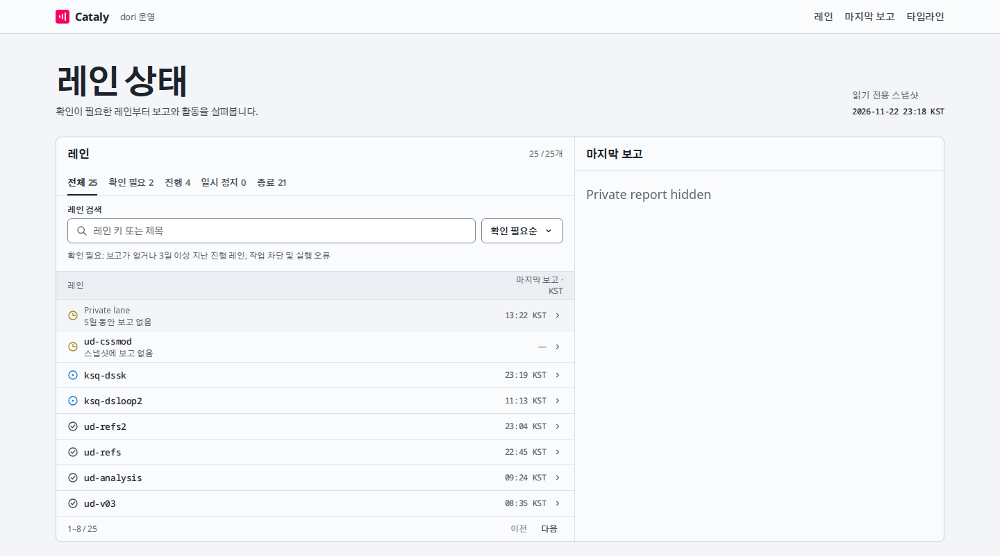

# Ultradesign v0.0.60

[한국어](#한국어) · [English](#english)

## 한국어

디자이너가 일하는 순서를 에이전트가 그대로 따릅니다. 에이전트는 단계마다 "이렇게 하겠습니다"를 처방하고 결과를 보여주며, 사용자는 객관식 대신 자기 말로 답합니다. 승인도 사용자 본인의 말로만 기록됩니다.

### 시작하기

Node.js와 로컬 체크아웃이 필요합니다. **작업할 프로젝트**에서 설치한 뒤 하네스를 다시 열어 주세요.

```sh
node /path/to/ultradesign/scripts/adapters.mjs install omp --scope project
```

`omp` 대신 `claude`, `codex`, `antigravity`, `opencode`, `cursor`, `gemini`를 지정할 수 있습니다. `--scope user`는 사용자 범위에 설치합니다. 기존 파일과 내용이 다르면 설치기가 경로를 알리고 멈춥니다. 이전 버전은 사용자 변경을 보존한 별도 위치에서 먼저 확인하세요. 한 OMP 세션에서만 쓰려면 `omp -e /path/to/ultradesign`으로 실행합니다.

```text
/ud 구현: 우리 제품의 랜딩 첫 화면을 개선해줘. 현재 카피, 제품 이미지, 시작하기 링크는 유지해.
```

OMP·Claude Code·Antigravity·OpenCode·Cursor·Gemini CLI에서는 `/ud` 또는 `/ultradesign`, Codex에서는 `$ud` 또는 `$ultradesign`을 씁니다. `계획만`은 프레임·구조·레퍼런스·방향·시스템 제안까지만 만들고 시스템 단계는 문서 제안으로 끝냅니다. `리뷰`는 현재 화면의 검토 결과만 보고합니다. 두 모드 모두 앱 코드를 수정하지 않습니다. `--full`/`--short`로 깊이를, `--shared`로 확인 후 공용 시스템 패키징을 지정합니다.

### 진행 순서

회사·브랜드·포트폴리오·랜딩·스크롤 스토리·몰입형 3D는 12단계 전체, 작은 페이지나 기존 시스템 위의 제품 화면은 짧은 경로(1·2·4·6·9·11·12단계와 브리프가 요구하는 단계)로 갑니다. 깊이는 사이트 유형으로 에이전트가 정하고 묻지 않습니다.

1. **프레임.** 사이트와 자료를 먼저 읽고, 도구로 알 수 없는 것만 최대 세 가지 열린 질문으로 묻습니다. 결과는 `brief.md`: 방문자, 핵심 과업, 브랜드 단어를 눈에 보이는 요구로 옮긴 표, 사이트 유형(장르 관례), 모션 강도와 느낌. 모르는 사실은 비워 두거나 가설로 표시합니다.
2. **구조와 카피.** 사이트맵, 오류·복구 경로가 있는 흐름, 실제 카피, 핵심 과업을 끝까지 해볼 수 있는 회색 프로토타입.
3. **레퍼런스 → 원리.** 실제 사이트 12–20곳을 모으고 에이전트가 3곳을 골라 카드로 분해합니다. 카드는 원리와 "가져오지 않는 것"(레이아웃·시그니처)을 적습니다. 레퍼런스는 레이아웃이 아니라 원리만 줍니다.
4. **방향.** 같은 콘텐츠로 서로 멀리 떨어진 세 방향을 만들고 하나를 추천합니다. 스타일스케이프, 대표 화면, 5–8초 모션 스케치를 보드로 봅니다. 텍스트만 있는 섹션과 레퍼런스와의 레이아웃 유사도를 검사합니다.
5. **에셋과 위험 스파이크.** 키 비주얼, 이미지 규칙, 출처 기록(`assets.json`), 가장 어려운 장면을 실제 브라우저에서 돌려 비용을 잽니다.
6. **시스템.** `DESIGN.md`(상태 행렬, 이미지 규칙, 모션 토큰, 장면 예산) → `tokens.css`/`tokens.ts` → Storybook. 빌드한 Storybook이 시스템 확인 화면입니다.
7. **모션.** 필수 단계입니다. 모션의 역할, 원칙, 스토리보드, 녹화된 애니매틱, 방해·포커스·모바일·모션 줄이기 동작 명세를 확인받습니다.
8. **구성 맵.** 섹션마다 위계 표, 에셋, 모션, 시각 역할, 상태, 반응형 규칙.
9. **얇은 슬라이스.** 핵심 과업 하나를 모든 상태(정상·로딩·빈 화면·실패·권한)로 끝까지 만들어 브라우저에서 확인받습니다.
10. **확장.** 나머지 화면. 새 컴포넌트가 생길 때만 질문합니다.
11. **독립 검토.** 만들지 않은 검토 에이전트가 [Remorsearch](https://github.com/remorser58/remorsearch_ux_qa_skill)와 자동 검사로 기준선 이후 최대 세 번 수정·재실행합니다.
12. **최종 확인.** 390/1440 화면, 녹화, 증거 장부, 13개 완료 기준 체크리스트. 실제 사용자 검증 칸은 사용자만 채우며 비어 있으면 비어 있다고 적습니다.




v0.0.50 시스템 화면의 색·글자 견본과 승인된 Cataly Ops 화면 예시입니다. 원본 연구 렌더에서 필요한 영역을 잘라 내고 개인 보고 내용을 가렸습니다.

### OMP에서 결정 기록하기

게이트에서는 에이전트가 보여준 결과를 보고 그냥 자기 말로 답합니다. 확장이 입력한 답을 직접 기록하고, 에이전트는 그 답에서 그대로 인용한 구절로만 승인을 기록할 수 있습니다.

```text
/ud approve directions 이 방향으로 진행해 주세요
/ud revise structure 연락 버튼이 첫 화면에서 눈에 안 띄어요
/ud real-user 원장님 두 분이 직접 문의 메일을 보내 봤다
/ud status
/ud resume
/ud off
```

`/ud approve <gate-id> [말]`, `/ud revise <gate-id> <피드백>`, `/ud real-user <메모>`(증거 장부의 실제 사용자 칸을 채우는 유일한 방법), `/ud resume`, `/ud status`, `/ud off`를 씁니다. 게이트 ID는 `frame`, `structure`, `references`, `directions`, `assets`, `system`, `motion`, `map`, `slice`, `buildout`, `final`입니다. 다른 하네스는 `progress.md`와 `decisions.md`에서 같은 순서를 따릅니다. v0.0.50 이전 세션은 저장된 근거를 보존하고 새 `/ud` 작업으로 시작합니다. 결정과 실패 기록은 [docs/lessons.md](docs/lessons.md)에 있습니다.

## English

The agent follows a design studio's order of work. At every stage it prescribes what it will do and shows the result; you answer in your own words, never from a menu, and approval is recorded only from your own words.

### Start

Use Node.js and a local checkout. Run the [installation command](#시작하기) from the target project, then restart your harness. Pass `--scope user` for user-wide installation. The installer refuses to overwrite different files; test an upgrade in a fresh directory or retain your customizations first. For one OMP session, run `omp -e /path/to/ultradesign`.

Use `/ud` or `/ultradesign` in OMP, Claude Code, Antigravity, OpenCode, Cursor, and Gemini CLI; use `$ud` or `$ultradesign` in Codex.

```text
/ud Implement a clearer landing hero. Keep the current copy, product artwork, and Get Started destination.
```

`plan` stops after frame, structure, references, directions and a written system proposal. `review` runs a read-only review baseline on the current screen. `--full` or `--short` fixes the depth; `--shared` prepares sharing after final approval.

### Workflow

Brand, portfolio, landing, scroll-story and immersive sites run all 12 stages. A small page or product screens on an existing system run the short path (stages 1, 2, 4, 6, 9, 11, 12 plus any stage the brief needs). The agent chooses the depth from the site type and does not ask.

1. **Frame.** Read the site and material first; ask at most three open questions, only about facts tools cannot find. Output: `brief.md` with brand words as observable requirements, the genre's conventions, motion intensity and register; unknown facts stay open or marked as hypotheses.
2. **Structure and copy.** Sitemap, flows with error and recovery paths, real copy, a grey prototype that completes the core task.
3. **References to principles.** Capture 12–20 real sites; the agent picks three and writes a deconstruction card each: principles, plus what is not carried (layout, signature elements).
4. **Directions.** Three directions on the same content, far apart; one is recommended. Stylescape, representative screen, a 5–8 s motion sketch; text-only and originality checks first.
5. **Assets and risk spike.** Key visuals, imagery rules, provenance in `assets.json`, the hardest scene measured in the target browser.
6. **System.** `DESIGN.md` with a state matrix, imagery rules, motion tokens and a scene budget → `tokens.css` / `tokens.ts` → Storybook; the built Storybook is the system gate.
7. **Motion.** A required stage: role of motion, storyboard, a recorded animatic, a behavioural spec with reduced-motion versions.
8. **Composition map.** Per section: hierarchy table, asset, motion beat, visual role, states, responsive rule.
9. **Slice.** One core task with normal, loading, empty, failure and permission states, used by you in the browser.
10. **Build-out.** The remaining screens; a question only when a new component appears.
11. **Independent review.** A reviewer that did not build the page runs [Remorsearch](https://github.com/remorser58/remorsearch_ux_qa_skill) and automated checks; up to three fix and replay rounds.
12. **Final.** Renders at 390 and 1440, a recording, an evidence ledger (agent success, automated checks, owner approval, real-user validation) and 13 completion criteria. Only you fill the real-user row; an empty row is stated as empty.

See the [system and approved screen examples](#진행-순서) above.

### OMP checkpoints

At a gate the agent shows the artifact, one line on why it fits your brief, what to look at, and one open question. Reply in your own words; the extension records your reply. Use `/ud approve <gate> [words]`, `/ud revise <gate> <feedback>`, `/ud real-user <note>`, `/ud resume`, `/ud status` and `/ud off`. Gates: `frame`, `structure`, `references`, `directions`, `assets`, `system`, `motion`, `map`, `slice`, `buildout`, `final`. Start a new workflow when upgrading earlier sessions; legacy progress does not count as v0.0.60 approval. Decisions and failures behind v0.0.60: [docs/lessons.md](docs/lessons.md).

OMP keeps stage-routing settings: `ULTRADESIGN_MODEL` and `ULTRADESIGN_THINKING_LEVEL` set common defaults. `ULTRADESIGN_MODELS='{"review":{"model":"provider/judge","thinkingLevel":"high"}}'` overrides by stage (`frame`, `structure`, `references`, `directions`, `assets`, `system`, `motion`, `map`, `slice`, `buildout`, `review`, `final`, `sharing`). Default build routing is Sol 6.2 high; review uses Opus 4.6 high. Use models available to your harness.

## Tools

Run the tools below from the checkout. Installed adapters carry the same tools in the canonical skill's `scripts/` directory; invoke those files with `uv run --script`.

```sh
scripts/reference-board 'developer tool landing hero' --kind mood --platform web --screenshot
scripts/palette-board --input palettes.json --out palette.html
scripts/stylescape-board --input directions.json --out board/index.html
scripts/animatic --url http://127.0.0.1:5173/animatic.html --out out/animatic --widths 1440,390
scripts/design-tokens DESIGN.md --out generated/tokens.css --ts generated/tokens.ts --catalog generated/catalog.generated.json
scripts/design-lint DESIGN.md
scripts/a2ui-validate --catalog catalog.json --screen screen.json --hierarchy hierarchy.json
scripts/hierarchy-check --url http://127.0.0.1:5173/?screen=handoff --hierarchy hierarchy.json --out qa/hierarchy
scripts/screen-map composition.json --out map/index.html
scripts/text-only-lint --url http://127.0.0.1:5173/ --map composition.json --widths 390,1440 --out qa/text-only
scripts/originality-check --url http://127.0.0.1:5173/ --reference https://example.org/ --width 1440 --out qa/originality
scripts/scene-qa --url http://127.0.0.1:5173/ --profile desktop-1440 --out qa/scene
```

The [build guard](skills/ultradesign/assets/templates/guard/README.md) is a template the agent installs in the renderer project as `prebuild`; `motionEntries` and `sceneEntries` let motion and scene files use GSAP, Motion and Three.js. The [Storybook template](skills/ultradesign/assets/templates/storybook/README.md) is the system gate. `animatic` and `scene-qa` need Playwright Chromium; `animatic` also needs `ffmpeg`. Frame rates from headless or SwiftShader runs are lab numbers, not device numbers.

With permission to use the owner's Chrome, add `--cdp http://127.0.0.1:9222` and repeat `--candidate URL "What to compare"` for eligible first-party pages. The tool opens fresh read-only tabs and records access gaps. Manual-only sources stay browse links. With no CDP connection the public adapters work independently. Keep the board, sourced captures and run artifacts private. Install `uv` and Playwright Chromium for rendering, and use the upstream Google Labs CLI for lint. Details: [workflow](skills/ultradesign/SKILL.md) · [open questions](skills/ultradesign/references/questions.md) · [role briefs](skills/ultradesign/references/roles.md) · [source catalog](skills/ultradesign/references/catalog.md) · [A2UI catalog guide](skills/ultradesign/references/a2ui.md) · [hierarchy and composition map](skills/ultradesign/references/hierarchy.md) · [method notes](references/method-trace.md) · [v0.0.60 plan](docs/v0.0.60-plan.md).

소유자가 명시적으로 허용한 실제 제품 화면은 `--target-url URL`로 추가합니다. 비교 후보와 분리해서 캡처하며, 해당 URL에만 `robots.txt` 검사 예외를 적용합니다. 제3자 출처의 정책과 브라우저 접근 제한은 유지합니다.

Add `--target-url URL` for each explicitly authorized product page. Current-screen captures are separate from picks. Only those exact URLs are exempt from robots checks; third-party policies and browser access checks remain in force.

## Verification

```sh
bun test
bun run test:host
node tests/visual-qa-smoke.mjs
uv run --script tests/a2ui-tools-smoke.py
skills-ref validate skills/ultradesign
node scripts/adapters.mjs generate all --out dist/v0.0.60
git diff --check
```

Generated adapters are local bundles, not published packages. The [historical one-shot evals](evals/README.md) are retained for v0.0.10–v0.0.30 provenance; they do not measure v0.0.40 or later. The [v0.0.50 hierarchy eval](evals/v0.0.50/README.md) compares generation with and without the hierarchy layer.
