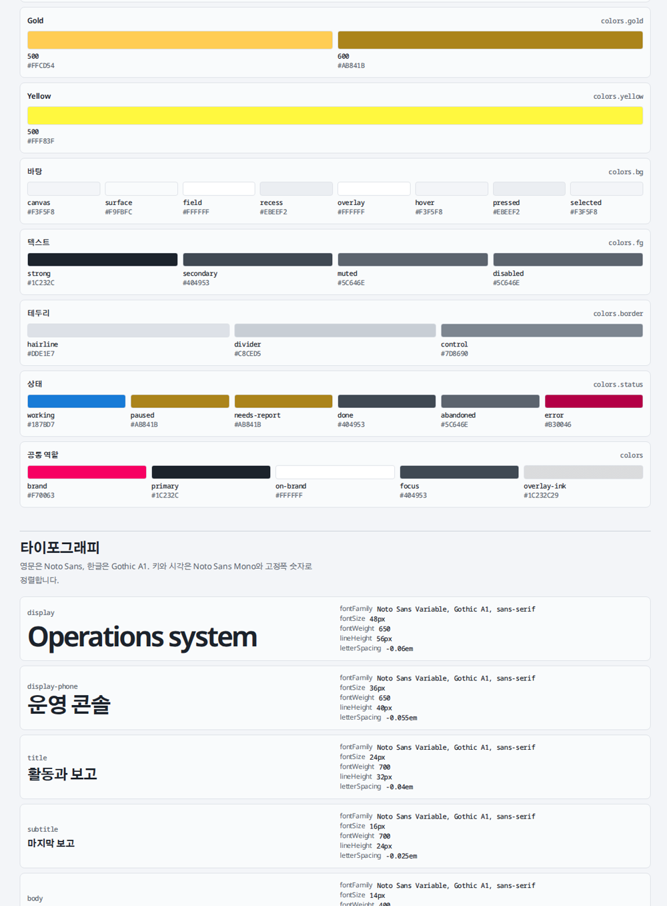

# Ultradesign v0.4

[한국어](#한국어) · [English](#english)

## 한국어

레퍼런스는 에이전트가 모으고, 어떤 디자인이 맞는지는 사람이 고릅니다. 고른 화면을 바탕으로 시스템을 만들고, 확인받은 뒤 실제 UI를 구현하고 검증합니다.

### 시작하기

Node.js와 로컬 체크아웃이 필요합니다. **작업할 프로젝트**에서 설치한 뒤 하네스를 다시 열어 주세요.

```sh
node /path/to/ultradesign/scripts/adapters.mjs install omp --scope project
```

`omp` 대신 `claude`, `codex`, `antigravity`, `opencode`, `cursor`, `gemini`를 지정할 수 있습니다. `--scope user`는 사용자 범위에 설치합니다. 기존 파일과 내용이 다르면 설치기가 경로를 알리고 멈춥니다. 이전 버전은 사용자 변경을 보존한 별도 위치에서 먼저 확인하세요. 한 OMP 세션에서만 쓰려면 `omp -e /path/to/ultradesign`으로 실행합니다.

```text
/ud 구현: 우리 제품의 랜딩 첫 화면을 개선해줘. 현재 카피, 제품 이미지, 시작하기 링크는 유지해.
```

OMP·Claude Code·Antigravity·OpenCode·Cursor·Gemini CLI에서는 `/ud` 또는 `/ultradesign`, Codex에서는 `$ud` 또는 `$ultradesign`을 씁니다. `계획만`은 시스템 제안에서 멈추고, `리뷰`는 현재 화면의 QA 결과를 보고합니다. 두 모드 모두 앱 코드를 수정하지 않습니다.

### 진행 순서

1. 실제 제품, 화면, 콘텐츠와 사용자의 핵심 과업을 확인합니다.
2. 핵심 갤러리와 화면에 맞는 공개 출처를 살펴 번호가 붙은 보드를 만듭니다. 사용자가 1–3개를 고릅니다.
3. 방향·폰트·팔레트·상태 표시·밀도를 한 번에 하나씩 묻습니다. 각 선택지에 실제 근거를 붙이고 추천과 사용자 결정을 따로 기록합니다.
4. 선택을 Google Labs 형식 `DESIGN.md`에 반영하고 `tokens.css`를 생성합니다. 실제 컴포넌트 변형이 보이는 `/system`을 사용자에게 확인받습니다. 신규 프로젝트의 기본은 Vite + React, Base UI, CSS Modules입니다. 기존 스택은 유지합니다.
5. 고른 레퍼런스의 구도를 우리 컴포넌트로 먼저 재현합니다. 다음 샷에서 실제 콘텐츠와 동작을 연결하고 불필요한 시각 요소를 덜어냅니다.
6. [Remorsearch UX QA](https://github.com/remorser58/remorsearch_ux_qa_skill)로 데스크톱·태블릿·휴대폰의 과업을 점검합니다. 기준선 이후 같은 시나리오에서 수정·재실행을 최대 세 번 반복합니다. 외부 스킬이 없으면 로컬 검증으로 진행하고 범위 차이를 명시합니다.
7. 실제 화면과 QA 근거를 보여주고 최종 확인을 받습니다. 모션은 요청이 있을 때 별도로 검증합니다.




`/system`의 색·글자 견본과 승인된 Cataly Ops 화면 예시입니다. 원본 연구 렌더에서 필요한 영역을 잘라 내고 개인 보고 내용을 가렸습니다.

### OMP에서 결정 기록하기

```text
/ud pick 2,5 정보 구조는 2번, 행동 버튼 위계는 5번
/ud answer direction 2
/ud approve system
/ud approve final
```

현재 단계와 질문은 `/ud status` 또는 `/ud resume`으로 확인합니다. `/ud revise <gate-id> <피드백>`은 같은 게이트에서 다시 검토하고, `/ud off`는 정책을 끕니다. `--motion`은 최종 확인 전 모션 패스를, `--shared`는 확인 후 공용 시스템 패키징을 추가합니다. v0.3 이전 세션에서는 저장된 근거를 보존하고 새 `/ud` 작업으로 시작합니다. 다른 하네스는 작업 기록과 대화에서 같은 결정 순서를 따릅니다.

## English

The agent does the research and implementation. You choose the references and approve what gets built.

### Start

Use Node.js and a local checkout. Run the [installation command](#시작하기) from the target project, then restart your harness. Pass `--scope user` for user-wide installation. The installer refuses to overwrite different files; test an upgrade in a fresh directory or retain your customizations first. For one OMP session, run `omp -e /path/to/ultradesign`.

Use `/ud` or `/ultradesign` in OMP, Claude Code, Antigravity, OpenCode, Cursor, and Gemini CLI; use `$ud` or `$ultradesign` in Codex.

```text
/ud Implement a clearer landing hero. Keep the current copy, product artwork, and Get Started destination.
```

`plan` ends at a system proposal. `review` runs a read-only QA baseline on the current screen.

### Workflow

1. Frame the real product, screen, content and user tasks.
2. Review a numbered board of task-specific references. Pick one to three and say what to keep.
3. Answer one evidence-backed question at a time: direction, type, palette, status treatment and density. The agent recommends one option and records your decision.
4. Review the live `/system` built from Google Labs `DESIGN.md` and generated tokens. New projects start with Vite + React, Base UI and CSS Modules; existing projects keep their stack.
5. Reconstruct the reference with your components, then adapt it to real content and behavior. Simplify visual grouping in the second shot.
6. Replay real UX tasks at desktop, tablet and phone sizes with Remorsearch. Fix and rerun the same scenarios in up to three rounds after the baseline. Without the external skill, the local fallback reports what it could check.
7. Confirm the current build in the final review. Motion is a separate, opt-in pass.

See the [/system and approved screen examples](#진행-순서) above.

### OMP checkpoints

Use `/ud pick 2,5 [why]`, `/ud answer direction 2`, `/ud approve system`, and `/ud approve final` at the corresponding gates. Use `/ud revise <gate-id> <feedback>` to request an updated artifact. `/ud status` reads the checkpoint, `/ud resume` returns to it, and `/ud off` deactivates the workflow. Optional `--motion` adds a pass before final review; `--shared` prepares sharing after approval. Start a new workflow when upgrading earlier sessions; legacy progress does not count as v0.4 approval.

OMP keeps stage-routing settings: `ULTRADESIGN_MODEL` and `ULTRADESIGN_THINKING_LEVEL` set common defaults. `ULTRADESIGN_MODELS='{"qa":{"model":"provider/judge","thinkingLevel":"high"}}'` overrides by stage (`frame`, `references`, `interview`, `system`, `implementation`, `qa`, `motion`, `final`, `sharing`). Default build routing is Sol 6.2 high; QA uses Opus 4.6 high. Use models available to your harness.

## Tools

Run the tools below from the checkout. Installed adapters carry the same tools in the canonical skill's `scripts/` directory; invoke those files with `uv run --script`.

```sh
scripts/reference-board 'developer tool landing hero' --kind mood --platform web --screenshot
scripts/palette-board --input palettes.json --out palette.html
scripts/design-tokens DESIGN.md --out src/tokens.css --catalog src/catalog.generated.json
scripts/design-lint DESIGN.md
```

With permission to use the owner's Chrome, add `--cdp http://127.0.0.1:9222` and repeat `--candidate URL "What to compare"` for eligible first-party pages. The tool opens fresh read-only tabs and records access gaps. Manual-only sources stay browse links. With no CDP connection the public adapters work independently. Keep the board, sourced captures and interview artifacts private. Install `uv` and Playwright Chromium for rendering, and use the upstream Google Labs CLI for lint. Details: [workflow](skills/ultradesign/SKILL.md) · [source catalog](skills/ultradesign/references/catalog.md) · [method notes](references/method-trace.md).

소유자가 명시적으로 허용한 실제 제품 화면은 `--target-url URL`로 추가합니다. 비교 후보와 분리해서 캡처하며, 해당 URL에만 `robots.txt` 검사 예외를 적용합니다. 제3자 출처의 정책과 브라우저 접근 제한은 유지합니다.

Add `--target-url URL` for each explicitly authorized product page. Current-screen captures are separate from picks. Only those exact URLs are exempt from robots checks; third-party policies and browser access checks remain in force.

## Verification

```sh
bun test
bun run test:host
node tests/visual-qa-smoke.mjs
skills-ref validate skills/ultradesign
node scripts/adapters.mjs generate all --out dist/v0.4.0
git diff --check
```

Generated adapters are local bundles, not published packages. The [historical one-shot evals](evals/README.md) are retained for v0.1–v0.3 provenance; they do not measure v0.4.
